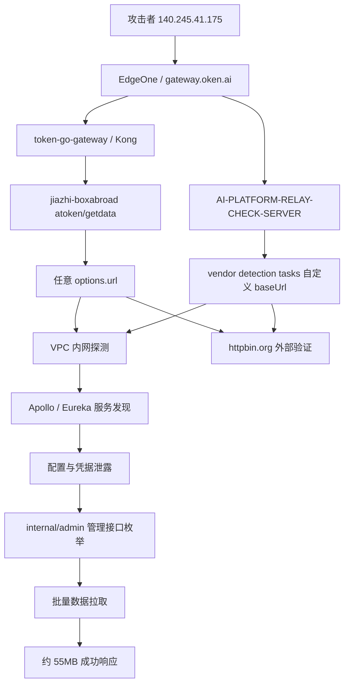

# SSRF 攻击复盘与防护手册

> 💡 **文档定位：**本文前半部分是本次生产环境 SSRF 攻击复盘，后半部分是 SSRF 漏洞原理与防护手册。文中不包含真实凭据、完整密钥或可复用的攻击细节；所有数据均来自华为云 LTS 日志证据。

# 执行摘要

本次事件不是随机扫描，而是一次已经成功的 **SSRF → 内网服务发现 → 配置与凭据泄露 → 管理接口枚举 → 批量数据拉取** 攻击链。攻击者利用两个可由外部触发的服务端请求能力，访问了 VPC 内部配置中心、服务注册中心、ClickHouse/CloudTable 管理端口和内部网关接口。

- **主要攻击源 IP：**140.245.41.175，经 EdgeOne/CDN 转发后仍保留在 `Eo-Connecting-Ip` 与 `X-Forwarded-For` 中。
- **核心 SSRF 入口：**`jiazhi-boxabroad / atoken/getdata` 的 `options.url`，以及 relay-check-server 的自定义 `baseUrl` 检测任务。
- **已确认 SSRF 请求：**774 次，其中 632 次返回 200，覆盖 292 个不同目标 URL。
- **已确认数据外流：**约 55MB 成功响应，包括约 33MB 供应商配置、约 16MB 检测平台报表、约 4.19MB 检测任务详情。
- **最高危影响：**Apollo 配置中心内容被读取，日志证据显示 Redis 与 ClickHouse 连接信息已暴露。
- **当前未关闭缺口：**Goms-Token 可持续铸造的签发入口尚未定位；boxabroad 是否向客户端回传上游完整响应体仍需应用日志或测试环境复现确认。

# 攻击链路总览



# 事件时间线

| 时间 | 阶段 | 行为 | 证据结论 |
|-|-|-|-|
| 2026-10-16 14:45 前后 | 资产侦察 | 攻击源 IP 拉取前端入口、主 bundle、source map 与新版前端资源 | 疑似从前端代码枚举服务名、接口路径与参数；此点为合理推断 |
| 2026-10-18 14:15 | 管理接口探测 | 请求 `/admin/env?%2Fv1%2Fmessages` | 返回 404，属于失败探测，不是主攻击链 |
| 2026-10-18 15:41 | 内网配置读取 | relay-check-server 根据自定义 baseUrl 请求配置中心，任务响应中记录 Apollo 配置内容 | 确认服务端可读取并保留内部配置；Redis 与 ClickHouse 连接信息暴露 |
| 2026-10-19 16:24 | SSRF 系统化利用 | 通过 boxabroad 的 `atoken/getdata` 请求内网基础组件与配置中心 | 4 秒内命中多个内网目标，呈现自动化脚本特征 |
| 2026-10-19 16:26–16:28 | 服务发现 | 访问 `/info`、`/apps`、`/services/config`、`/eureka/apps` | 确认服务注册与配置中心可访问，服务名可枚举 |
| 2026-10-20 14:00–15:05 | 内网横向探测 | 对 VPC、CloudTable、内部域名、httpbin、loopback 发起 SSRF | 368 次 VPC 请求中 258 次成功；180 次云托管目标中 151 次成功 |
| 2026-10-20 15:52–16:25 | 管理接口枚举 | 高频枚举 `/internal/v1/*`、`/skill/v1/*` | 找到多个真实 internal 接口并返回 200 |
| 2026-10-20 16:15–16:31 | 批量取数 | 请求供应商配置、平台报表、检测任务详情 | 925 次 200，约 53.4MB 响应 |
| 2026-10-20 18:00–19:00 | 重定向与检测任务利用 | 通过 httpbin redirect、openrouter、vendor detection tasks 继续测试 | 存在成功请求，也出现 400/500；攻击面仍可用 |
| 2026-10-20 22:00–22:17 | SSRF 存活验证 | 反复请求 `https://httpbin.org/get` 与 `/metrics` | 15 次 httpbin 请求全部外层 200、上游 200；metrics 返回约 260KB/次 |

# 核心问题一：攻击者如何知道 Apollo 配置地址

## 已确认的发现路径

1. 攻击者先拥有任意 URL 请求能力，可通过 `options.url` 让服务端访问内网地址。
2. 2026-10-19 16:24:43，首个配置中心探测请求命中 `10.117.98.80:8080/info`，返回 200，确认基础服务存活。
3. 随后攻击者访问 `/apps`、`/services/config`、`/eureka/apps`，均返回 200。
4. `/eureka/apps` 通常暴露服务名、实例地址、端口、健康检查地址与元数据，可解释攻击者为何能快速获得服务清单。
5. 攻击者再按 Apollo 标准 `/configfiles/json/{appId}/{env}/{namespace}` 路径批量读取配置。

## 关键证据

```text
16:24:43  GET /info                         200
16:28:31  GET /apps                          200
16:28:33  GET /services/config               200
16:28:35  GET /eureka/apps                   200

16:26:21 起  GET /configfiles/json/{service}/prod/application  200
```

## 判断与待验证假设

## Apollo 配置读取范围

日志证据显示攻击者至少尝试读取以下类别配置：

- **密钥管理：**AI-PLATFORM-OKEN-KEY-MANAGE-SERVER，prod/default/application。
- **检测服务：**AI-PLATFORM-RELAY-CHECK-SERVER、AI-PLATFORM-TOKEN-DETECTION-ADMIN。
- **监控服务：**AI-PLATFORM-TOKEN-MONITOR-SERVER-ADMIN。
- **平台入口：**AI-PLATFORM-GATEWAY、AI-PLATFORM-JOB、AI-PLATFORM-AGENT-API。
- **聚合服务：**AI-PLATFORM-AIPOLYMERIZATION、sh.aipolymerization、aipolymerizationadmin、aipolymerizationapi。
- **配置文件名：**application、config.yaml、config.yml、application.yml 等常见命名均被尝试。

## 泄露内容类型

| 配置项 | 风险 | 处置 |
|-|-|-|
| Redis 地址与认证 | 可能读写缓存、会话、业务状态 | 立即轮换密码并审计命令 |
| ClickHouse/CloudTable 地址与认证 | 可能查询用量、模型数据、业务数据 | 轮换账号密码并审计查询 |
| 服务依赖地址 | 辅助横向移动与接口伪造 | 收敛内网访问策略 |
| 模型目录与业务参数 | 暴露供应商与模型结构 | 降低配置可见性 |
| requestAudit userIds | 暴露内部用户 ID 与审计策略 | 重新评估配置泄露面 |

> 🔒 **注意：**本节只描述类型和影响，不引用真实密码、完整连接串或可直接复用的配置值。详细值应在内部受控事故单中另行保存。

- **已确认：**攻击者能访问配置中心与服务注册中心，并能按 Apollo 标准路径读取配置。
- **高可信推断：**服务名来自 `/eureka/apps` 或 `/apps`，而非凭空猜测。
- **待验证：**首个内网 IP 是通过网段扫描发现，还是来自此前泄露的配置、前端代码或外部情报。4 秒内命中多个目标更像已有目标列表或自动化脚本。

# 核心问题二：httpbin.org/get 是否成功

## 日志结果

2026-10-20 22:00–22:17，攻击者通过 `atoken/getdata` 请求 `https://httpbin.org/get`：

- 共 15 次请求；
- 15 次 `code=200`；
- 15 次 `upstream_status=200`；
- 响应 `size=37` 字节；
- 请求耗时约 2–5ms，链路稳定。

## 结论边界

## 代表性请求样本

| 时间 | 请求 ID | 外层状态 | 上游状态 | 响应大小 |
|-|-|-|-|-|
| 22:12:17 | c7897e8b02287c228d17dd072a9fdf82 | 200 | 200 | 37B |
| 22:12:20 | 0c7599ec9e99ad9c892030723d7b8f21 | 200 | 200 | 37B |
| 22:12:23 | f7279b5b92f043498dbc7ad868b5b3f4 | 200 | 200 | 37B |
| 22:12:26 | 4f17d187823b8b9f31efacab22ac55bc | 200 | 200 | 37B |
| 22:12:29 | d83043aa709b0041137ec751edfa1213 | 200 | 200 | 37B |
| 22:17:26 | f532b2cef9758128540a037b02f8efd9 | 200 | 200 | 37B |
| 22:17:31 | 32c84c1ae180ca4561e5a169f22ba204 | 200 | 200 | 37B |
| 22:17:36 | 9aaa711c1c86f06f18aeee390168dd63 | 200 | 200 | 37B |

## 为什么 37B 不能证明拿到响应体

1. httpbin /get 通常返回 headers、origin、url 等信息，完整 JSON 明显大于 37 字节。
2. 同一 37B 结果也出现在内网 ping、CloudTable 根路径、内部域名等不同目标上，说明更像固定包装。
3. Kong 日志只记录外层响应大小，不代表上游 body 被转发。
4. 因此只能证明“服务端成功请求目标”，不能证明“目标响应内容被返回给攻击者”。

## 验证方案

1. 在测试环境用同样参数调用 boxabroad，检查返回 JSON 字段。
2. 查这些请求 ID 在 boxabroad 应用日志中的返回体或数据库落库内容。
3. 如接口只返回状态，标记为半盲 SSRF；如返回 body，标记为基本 SSRF。
4. 补充 egress 抓包，确认上游响应是否被应用读取并转发。

| 问题 | 结论 | 依据 |
|-|-|-|
| 服务端是否成功请求 httpbin | 已确认成功 | 外层与上游均为 200 |
| 服务端是否具备公网 HTTPS 出网能力 | 已确认具备 | https 请求稳定返回 200 |
| 攻击者是否拿到 httpbin 完整响应体 | 不能确认 | 外层响应仅 37 字节，疑似固定包装 |
| 该入口是否可用于内网探测 | 已确认 | 内网 IP、CloudTable、内部域名均返回 200 |
| 是否存在其他响应体读取入口 | 已确认 | relay-check-server 任务日志中保留了上游响应内容 |

> 🔎 **解释：**不同目标 URL 均稳定返回约 37 字节，说明 boxabroad 对外可能只返回固定状态包装。它至少提供了“任意 URL 请求 + 内网可达性探测”能力；是否能直接回传上游 body，需要结合 boxabroad 应用日志、数据库记录或测试环境复现确认。

# 影响面统计

## SSRF 目标分类

| 目标类型 | 请求数 | 200 数 | 风险说明 |
|-|-|-|-|
| VPC 内网地址 | 368 | 258 | 内网端口与服务探测、配置读取 |
| 华为云托管 / CloudTable | 180 | 151 | 数据库管理端口可达 |
| 内部/公开域名服务 | 117 | 115 | 跨服务接口访问 |
| httpbin 外部验证 | 92 | 92 | 验证出网、headers、redirect、IP |
| loopback | 2 | 2 | 本机服务可探测 |
| 其他目标 | 15 | 14 | 待归类复核 |

## 成功拉取的数据

## 管理接口成功明细

| 接口 | 200 次数 | 响应体积 | 潜在影响 |
|-|-|-|-|
| /internal/v1/supplier | 140 | 1.44MB | 供应商与上游配置枚举 |
| /internal/v1/crawler/shops | 2 | 38.8KB | 爬虫与店铺信息 |
| /internal/v1/shops | 2 | 38.3KB | 店铺信息 |
| /internal/v1/shop/commission-config | 2 | 29.9KB | 佣金或计费配置 |
| /internal/v1/sku-groups | 6 | 16.0KB | SKU 分组配置 |
| /internal/v1/token/llm/model/group | 13 | 1.8KB | 模型与分组关系 |
| /atoken/getdata | 39 | 1.4KB | SSRF 可用性确认 |
| /internal/v1/manufacturers 等 | 9 | 约 39KB | 厂商与分组信息 |

## 批量取数明细

- **suppliers：**544 次成功，33.0MB；324 个不同 SKU，覆盖 Claude、GPT、Gemini、DeepSeek、Qwen、Grok、Kimi、Minimax 等模型族。
- **platform-reports：**133 次成功，16.1MB；完整拉取第 1–105 页，并探测 150、200、262 页；常规页约 130KB，越界页约 343B。
- **detection tasks：**237 个不同任务，4.19MB；包含任务详情与 checkpoints。
- **聚合结果：**925 次 200，约 53.4MB。
- **查询效率：**大量请求集中在 16:15–16:31，呈脚本化连续取数特征。

| 数据面 | 成功次数 | 响应体积 | 说明 |
|-|-|-|-|
| 供应商配置 `/api/v1/suppliers` | 544 | 约 33.0MB | 324 个不同 SKU 查询 |
| 检测平台报表 | 133 | 约 16.1MB | 108 个页码，覆盖 1–105、150、200、262 |
| 检测任务详情 | 237 个任务 | 约 4.19MB | 任务详情与 checkpoints |
| internal 管理接口 | 209 | 约 1.58MB | supplier、shops、commission config 等 |
| metrics | 多次 | 约 260KB/次 | 可能暴露实例、路由与业务统计 |

# 认证异常：Goms-Token 铸造

在 1000 条错误日志中解析出 128 个不同 Goms-Token。其 JWT payload 大多仅包含：

```json
{
  "__level__": 1,
  "iat": 1792482766
}
```

大量 token 的 `iat` 按秒递增，且每个请求使用不同 token，说明攻击者能够持续获得新的一级 token，而不是简单复用一个泄露 token。

## 可能原因

## 证据特征

- 1000 条错误日志中出现 128 个不同 token。
- 绝大多数 token payload 仅含 `__level__=1` 和 `iat`，无用户、无受众、无授权范围。
- 相邻 token 的 `iat` 多数相差 1 秒，呈现自动签发特征。
- 同一请求的错误日志与网关 trace 中出现相同 `shreqid`，可按请求串联。
- 部分早期请求头含 `Userid: 1`，但大量请求没有稳定用户上下文。

## 建议排查路径

1. 按最早出现的 token `iat` 回溯前一分钟的网关、认证、登录、匿名会话请求。
2. 检查是否存在匿名 token、测试 token、内部探活 token 或开放签发接口。
3. 确认网关对 `__level__` 的语义：是否仅代表请求层级，却被误当作权限。
4. 检索代码与配置中所有 Goms-Token 签发逻辑，列出可调用主体。
5. 将 token 样本与签名密钥版本比对，确认是否同一密钥签发。
6. 对 128 个 token 建立清单：iat、首次使用时间、路径、结果、shreqid、来源 IP。

- 存在未鉴权或弱鉴权入口可铸造 level 1 token；
- 网关对 internal/admin 路由仅信任 `__level__`，未校验业务身份、scope 或受众；
- 某个客户端配置或前端流程暴露了 token 获取接口。

**该签发入口尚未定位，是当前最重要的未关闭缺口。**

# 已确认的安全缺陷

## 风险分级

| 风险 | 等级 | 理由 |
|-|-|-|
| Apollo 配置与凭据泄露 | 严重 | 日志确认配置内容被服务端读取并保留 |
| Goms-Token 可持续铸造 | 严重 | 128 个 token 按秒生成且可访问 internal 路由 |
| 任意内网 SSRF | 严重 | 774 次请求、632 次 200、292 个目标 |
| 约 55MB 数据成功返回 | 高 | 供应商、报表、任务详情和 internal 数据被拉取 |
| CloudTable 管理端口可达 | 高 | 认证参数已被构造并发送，需要审计后续查询 |
| metrics 暴露 | 中 | 可能泄露实例、路由与业务统计 |
| WAF 未记录攻击 | 中 | 攻击流量未被特征拦截或落攻击日志 |

1. **任意 URL SSRF：**boxabroad 接受用户控制的方法与 URL，未限制协议、域名、端口与 IP。
2. **第二个服务端请求面：**relay-check-server 允许自定义 baseUrl，并把响应保留在任务证据中。
3. **内网配置中心暴露：**Apollo/Eureka 可被业务服务替代访问。
4. **敏感配置外泄：**Redis 与 ClickHouse 连接信息出现在响应证据中。
5. **公网转发 internal/admin 路由：**攻击者可直接访问并取得 200。
6. **metrics 暴露：**公网可读取约 260KB 的指标数据。
7. **WAF 未拦截：**攻击日志流为空，主要依赖应用自然 404/401/403。
8. **token 可持续铸造：**128 个 token 按秒生成，签发链路待查。

# 应急止血清单

## 立即执行

1. 封禁攻击源 IP `140.245.41.175`，并保留完整日志与请求 ID。
2. 从公网网关下线或鉴权保护以下路径：`atoken/getdata`、vendor detection tasks、openrouter、`/internal/*`、`/admin/*`、`/metrics`。
3. 轮换 Redis、ClickHouse、Apollo 敏感配置、Goms-Token 签名密钥及可能暴露的业务 API Key。
4. 对 boxabroad 与 relay-check-server 实施默认拒绝出网，仅允许显式依赖目标。
5. 在网关和 WAF 添加高频路径枚举、异常 UA、异常分页、异常 token 速率的阻断规则。

## 证据保全

- 按 `shreqid` 导出 boxabroad、Kong、go-gateway、relay-check-server 全链路日志。
- 导出攻击者创建的检测任务、checkpoint、raw evidence 与任务参数。
- 审计 Apollo/Eureka 访问日志，确认读取过的 appId、namespace 与响应体。
- 审计 ClickHouse/CloudTable 查询日志，确认是否发生进一步数据查询或导出。
- 定位 128 个 Goms-Token 的签发服务、签发请求与认证上下文。

# 修复方案

## boxabroad SSRF 修复

1. 取消“用户提供完整 URL”的模型，改为平台 ID / 供应商 ID 白名单映射。
2. 如必须支持 URL，仅允许 HTTPS，并对协议、域名、端口使用允许列表。
3. DNS 解析后校验所有 A/AAAA 记录，拒绝环回、私有网段、链路本地、云 metadata 与 IPv6 受护范围。
4. 禁用重定向；如业务必须跟随，则每跳重新解析并校验。
5. 禁用非必要协议与自定义方法透传。
6. 外连统一走 egress proxy，代理层拒绝内网段与云 metadata。
7. 不向客户端回传上游原文；仅返回脱敏状态或错误码。

## relay-check-server 修复

1. `baseUrl` 不接受用户提交，改为服务端配置映射与平台白名单。
2. 目标健康检查与模型探测使用固定域名集合，禁止拼接任意 path/query。
3. 任务证据保存前执行敏感信息脱敏，禁止完整配置、headers、认证内容落盘。
4. 限制任务创建频率、并发与目标数量，并绑定操作者身份。

## 网关与认证修复

## 分层加固清单

| 层级 | 必须动作 | 验收标准 | 优先级 |
|-|-|-|-|
| 入口网关 | 下线公网 internal/admin 路由；对 SSRF 相关路由加白名单；阻断异常 UA 与高频路径枚举；公网 metrics 返回 404 | 公网无法访问 internal/admin/metrics；高危路径有审计日志 | P0 |
| 应用层 | 取消用户可控完整 URL；平台 ID → 服务端目标映射；DNS 解析后校验全部 IP；禁止重定向 | 请求 httpbin、10/8、127/8、169.254/16、云托管地址均被拒绝 | P0 |
| 网络层 | boxabroad 与 relay-check-server 默认拒绝出网；经 egress proxy 白名单出网；安全组收敛 | 仅允许显式依赖目标；代理层阻断内网段与 metadata | P0 |
| 配置中心 | Apollo/Eureka 增加认证；按服务身份授权；禁止未授权读取 configfiles；审计配置读取 | 无服务身份不能读取 /configfiles、/eureka/apps、/apps | P0 |
| 数据层 | 轮换 Redis/ClickHouse/API Key；审计异常查询；限制数据库账号来源与权限 | 旧凭据全部失效；无未授权查询成功记录 | P0 |
| 身份层 | 定位 Goms-Token 铸造入口；token 增加 exp/aud/sub/scope/jti；缩短有效期；强制服务端校验 | 无法匿名铸造；伪造/过期/越权 token 全部 401/403 | P0 |
| 观测层 | 记录 SSRF 目标、状态、耗时、响应长度、操作者；对同一 IP/账号/token 异常速率告警 | P1 |  |
| 流程层 | 上线前 SSRF 检查项；URL 类功能安全评审；红队回归测试；漏洞修复演练 | 新增“用户给 URL、服务端请求”功能必须通过安全门禁 | P1 |

## 建议阻断的路径与目标

| 类别 | 阻断对象 | 原因 |
|-|-|-|
| 公网路径 | `/v4/services/*/internal/*`、`/v4/services/*/admin/*`、`/metrics` | 本次已确认被枚举并返回 200 |
| SSRF 入口 | `atoken/getdata`、vendor detection tasks、openrouter 自定义上游 | 本次攻击的两个服务端请求面 |
| 内网 IP | `10/8`、`172.16/12`、`192.168/16`、`127/8`、`169.254/16`、IPv6 ULA/link-local | 基础 SSRF 防护边界 |
| 云托管服务 | 数据库、缓存、对象存储、配置中心、服务注册中心管理端口 | 本次 CloudTable、Apollo/Eureka 已被访问 |
| 重定向 | 302/301/307/308 跳转后的任意目标 | 攻击者已使用 httpbin redirect 测试绕过 |

1. `/internal/*`、`/admin/*` 不暴露在公网网关。
2. internal 调用使用服务身份 mTLS 或独立内网鉴权，不信任公网可获取的 Goms-Token。
3. Goms-Token 增加 `exp`、`aud`、`sub`、`scope`、`jti`，服务端强制校验。
4. 建立 token 签发审计与异常速率告警。
5. metrics 仅内网可见，公网返回 404。

# SSRF 基础知识

**SSRF（Server-Side Request Forgery，服务端请求伪造）**是一种安全漏洞：攻击者利用服务端提供的“替用户发起请求”的能力，诱使服务器去访问本不该访问的内部或受信资源。

## 基本原理

很多应用会有类似功能：

- 根据 URL 抓取网页预览或生成缩略图；
- 导入远程图片、文件；
- Webhook 回调配置；
- 从 URL 加载数据，例如 PDF 生成、解析、翻译等。

如果服务端直接使用用户可控 URL 发起请求，且没有校验目标地址，攻击者就可以把 URL 指向内网：

```yaml
https://example.com/fetch?url=http://169.254.169.254/latest/meta-data/
https://example.com/fetch?url=http://127.0.0.1:8500/admin
https://example.com/fetch?url=file:///etc/passwd
```

此时请求由服务器发出，因此能绕过防火墙和外网访问限制，到达攻击者从外部无法访问的位置。

## 主要危害

- **访问内网服务：**数据库管理台、Redis、Kubernetes API、内部管理系统等只监听 loopback 或内网 IP 的服务。
- **读取云元数据：**例如云厂商 metadata 地址，曾导致直接取得临时凭证。
- **端口与服务探测：**根据响应时间、错误差异扫描内网端口。
- **攻击内网应用：**向只允许可信来源的内部接口发 POST，执行管理操作。
- **配合其他漏洞：**例如利用特殊协议攻击 Redis/FastCGI，或利用本地文件协议读取文件。

## 常见类型

## 绕过手法与本次对应证据

| 手法 | 说明 | 本次证据 |
|-|-|-|
| 公网回显平台 | 通过 httpbin 观察出口 IP、headers、redirect | get/ip/headers/cookies/redirect-to 均被访问 |
| 302 重定向 | 外层 URL 合法，Location 指向内网 | httpbin redirect-to 指向 10.117.100.24 等地址 |
| URL authority 混淆 | 使用 `@`、分号等构造主机与路径歧义 | openrouter 路径中存在 `;@httpbin.org` 形态 |
| 内网 DNS/域名 | 公网域名解析到内网或经网关代理访问 | gateway-stg、modely-api、内部服务域名均可达 |
| 托管服务直连 | 绕过应用层直接访问云数据库端口 | CloudTable 8123 多次成功 |
| 固定包装判断 | 即使无 body，也可用状态码/耗时做探测 | 不同目标均返回 37B 固定包装 |

## 黑白名单的局限

- **黑名单：**难覆盖等价 IP、IPv6、十进制/十六进制 IP、短域名、DNS rebinding、重定向和新增内网段。
- **只校验域名：**DNS 结果可在校验后变化，或解析到内网地址。
- **只校验首个 IP：**多 A/AAAA 记录可让后续连接命中内网。
- **只限制协议：**无法阻止 HTTPS 内网域名或云托管服务访问。
- **依赖 WAF：**本次 WAF 攻击日志为空，说明特征不一定会命中。

| 类型 | 说明 |
|-|-|
| 基本 SSRF | 响应返回给攻击者，可直接看到内网返回内容 |
| Blind SSRF | 看不到响应，只能通过超时、日志、副作用判断 |
| 半盲 SSRF | 只能看到部分信息，例如状态码、长度、耗时 |

攻击者还常用绕过手法，例如特殊 IP 写法、短域名、`@` 语法、IPv6 映射地址、DNS rebinding、302 跳转到内网等。因此仅使用黑名单校验通常不可靠。

## 通用防御措施

1. **白名单校验目标：**限制协议、域名、端口，优先使用允许列表而非黑名单。
2. **禁用内网地址：**DNS 解析后检查所有 IP，拒绝环回、私有网段、链路本地地址及 IPv6 对应范围。
3. **防止 DNS rebinding：**校验 IP 后使用该 IP 建连，或校验全部解析结果。
4. **禁止重定向，或对每跳重新校验。**
5. **网络层隔离：**外访服务放独立网络或容器，统一 egress proxy，并在代理上封禁内网段。
6. **最小权限：**Web 服务不持有云凭证，云主机启用需要会话的 metadata 机制。
7. **限制协议与超时：**禁用非必要协议，设置超时和响应大小上限。
8. **不回显错误细节：**避免把内网响应、完整错误栈直接返回给用户。

# 后续排查优先级

1. **定位 Goms-Token 铸造入口：**重点回看 2026-10-20 15:52:46 前后，第一个 level 1 token 出现前的完整请求。
2. **导出 relay-check-server 攻击任务：**确认 raw evidence 中保存了哪些配置与响应体。
3. **审计 Apollo/Eureka：**列出被读取的 appId、namespace、响应大小与来源 pod。
4. **确认 supplier 数据敏感级别：**判断是否包含上游 key、成本、账号、endpoint。
5. **审计 ClickHouse/CloudTable：**确认 `SELECT 1` 与认证探测后是否有进一步查询。
6. **复现 boxabroad 响应行为：**验证 37 字节包装是否包含上游 body。

# 一句话总结

> 💡 **SSRF 就是把服务器当成“跳板”去访问内网或本机资源。**凡是“用户给 URL、服务器去请求”的功能，都必须做严格的目标地址校验、网络隔离、最小权限与响应脱敏。
